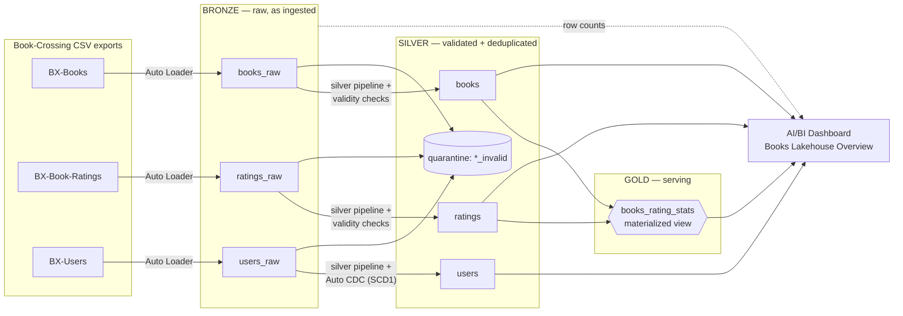
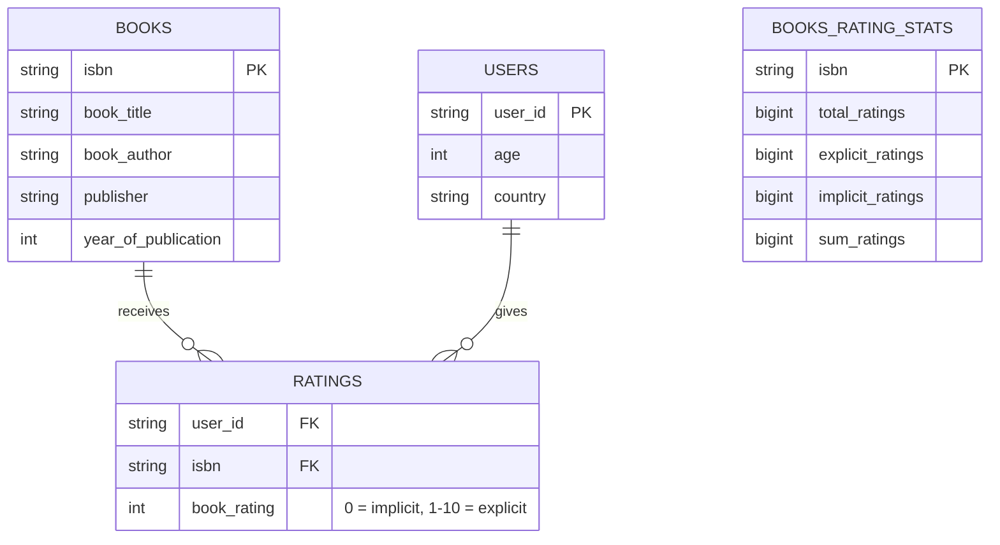
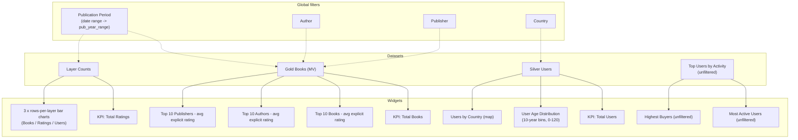

# Books Lakehouse — Architecture & Design

An end-to-end lakehouse for the Book-Crossing dataset, built on Databricks: medallion architecture (bronze → silver → gold), orchestrated as a **Declarative Automation Bundle (DAB)**, with an **AI/BI dashboard** as the serving layer.

---

## 1. High-level architecture



**One rule drives the whole design:** bad rows are **quarantined, never dropped**. Every stream keeps a parallel `*_invalid` table so data-quality issues stay visible and debuggable.

---

## 2. Repository layout (DAB)

The bundle name is `books_dataset` with two targets — **dev** (`books_dataset_dev`, default) and **prod** (`books_dataset_prod`). A single `catalog` variable switches environments.

```text
books_dataset/
├── databricks.yml                        # bundle + targets, ${var.catalog}, ${var.warehouse_id}
├── variables.yml                         # variable defaults
├── assets/
│   ├── ingestion_pipeline.yml            # bronze Auto Loader pipeline
│   ├── silver_pipelines.yml              # 3 pipelines: books / ratings / users
│   ├── checks.yml                        # job that deploys the UC SQL check functions
│   ├── gold_pipeline.yml                 # gold materialized view pipeline
│   └── dashboards.yml                    # dashboard resource (dataset_catalog per target)
├── dashboards/
│   └── Books_Lakehouse_Overview.lvdash.json
├── src/books_dataset/
│   ├── bronze/
│   │   └── autoloader.py                 # CSV ingestion from landing volume
│   ├── silver/
│   │   ├── tables/
│   │   │   ├── books.sql
│   │   │   ├── ratings.sql
│   │   │   └── users.sql                 # Auto CDC → SCD1 streaming table + quarantine
│   │   └── checks/
│   │       └── validity_checks.sql       # UC functions: valid_book_data / valid_ratings_data / valid_users_data
│   └── gold/
│       └── views/
│           └── books_rating_stats.sql    # book-grain rating stats materialized view
└── infra/terraform/                      # workspace-level infra (catalogs, warehouses)
```

---

## 3. Layer by layer

### Bronze — raw as ingested

* One managed table per source file: `bronze.books_raw`, `bronze.ratings_raw`, `bronze.users_raw`.
* **Original column names preserved** (e.g. `Book-Author`, `Year-Of-Publication`, `ISBN`) plus ingestion metadata (`_ingestion_time`).
* Ingested with **Auto Loader** from a landing volume; checkpoints and inferred schemas live in dedicated volumes (`bronze.checkpoints`, `bronze.schemas`).

### Silver — validated, deduplicated, normalized

Each stream is a Lakeflow Spark Declarative Pipeline producing two streaming tables:

| Stream | Passed (`silver.<name>`) | Quarantined (`silver.<name>_invalid`) | Quality gate |
| --- | --- | --- | --- |
| Books | one row per ISBN, latest wins | failed `valid_book_data` | `Year-Of-Publication` → `TRY_CAST` to INT, non-null author/publisher, … |
| Ratings | one row per user-book pair, latest wins | failed `valid_ratings_data` | rating in 0–10, known ISBN/user shape, … |
| Users | one row per user via **Auto CDC (SCD1)**, keyed on `user_id` | failed `valid_users_data` | age sanity, location split into country/city/state, lower/trim/`NULLIF` normalization |

Design details worth calling out:

* **Check functions are Unity Catalog SQL UDFs** (`valid_book_data`, `valid_ratings_data`, `valid_users_data`), deployed by a dedicated job as a parameterized SQL file (with a `{{catalog}}` placeholder), so the same logic is reusable and testable outside the pipelines.
* **Latest-version-wins dedup** on natural keys (ISBN / user-book pair / user_id) driven by `_ingestion_time`.
* ANSI mode is on, so casts use `TRY_CAST` — malformed strings are quarantined rather than crashing the pipeline.
* Re-ingesting an already-known key **updates in place** instead of appending a duplicate.

### Gold — one additive materialized view

Deliberately minimal: a single metric view at **book grain** that pre-aggregates ratings so the dashboard can re-aggregate by any dimension (title, author, publisher, year) without precomputed averages.

`gold.books_rating_stats` (materialized view, one row per ISBN):

| Column | Meaning |
| --- | --- |
| `isbn`, `book_title`, `book_author`, `publisher`, `year_of_publication` | book attributes (from silver books) |
| `total_ratings` | all ratings received (explicit + implicit) |
| `explicit_ratings` | ratings with value > 0 (the 1–10 scale) |
| `implicit_ratings` | ratings with value = 0 |
| `sum_ratings` | sum of explicit rating values |

The core principle — **store additive quantities, compute averages at query time**:

```sql
Avg Explicit Rating = ROUND(SUM(sum_ratings) / NULLIF(SUM(explicit_ratings), 0), 2)
```

Because both operands are additive, this recomputes correctly under *any* grouping (by author, publisher, period, …) and under any filter combination. Precomputed per-book averages would silently produce wrong averages when re-averaged across books. (Distinct-rater counts are intentionally **not** stored — they are non-additive and would be misleading when summed.)

---

## 4. Data model



---

## 5. Dashboard design — Books Lakehouse Overview

A single-page AI/BI dashboard built on **four deliberately simple SQL datasets**, each mapped to a specific widget group:

| # | Dataset | Source | Purpose |
| --- | --- | --- | --- |
| 1 | **Gold Books (MV)** | `gold.books_rating_stats` + publication-period parameter | KPI, top-10 rankings, author/publisher filters |
| 2 | **Layer Counts** | one `UNION ALL` of row counts per stream x layer (bronze / silver / quarantined / gold), period-guarded | Ratings KPI, three rows-per-layer bar charts |
| 3 | **Silver Users** | plain `SELECT` from `silver.users` (+ `age_bin`, normalized country names) | Users KPI, age histogram, country map, country filter |
| 4 | **Top Users by Activity** | `silver.ratings` grouped by user (explicit count, total count), top 10 each | two user tables, **unfiltered** |

### Widget and filter wiring



Key behaviour:

* **Rankings** group the gold MV by book / author / publisher, filter to books with **>= 3 explicit ratings**, and use the shared `Avg Explicit Rating` measure — the same additive SUM/COUNT formula, so rankings stay correct under every filter.
* **The two user tables are intentionally exempt from all filters** (widget-level ignore-filters): they always show the overall top-10 raters and top-10 buyers, and their titles say so with an `(unfiltered)` suffix.
* **Country names are normalized in SQL** for geocoding: `INITCAP(...)` plus a `usa -> 'United States of America'` fix-up, so the choropleth map resolves properly.
* **The age histogram** bins ages into 10-year buckets via a computed `age_bin` column in the dataset (null ages filtered out), plotted on a fixed 0-120 axis.

### Known data caveats

* Book-Crossing has **no rating timestamps** — the only time dimension is `year_of_publication`. The Publication Period filter therefore slices by publication year, never by rating date.
* The `>= 3 explicit ratings` threshold is tuned for the (small) dev dataset; with the full dataset it filters out noise books with a single rating.
* The dev environment runs on a sample of the data, so counts shown are dev-scale.

---

## 6. Deployment and environments

* `databricks bundle deploy -t dev` targets catalog `books_dataset_dev`; `-t prod` targets `books_dataset_prod`.
* The silver check functions are deployed by a dedicated job that rewrites `{{catalog}}` in the SQL file, so each environment gets its own copies of the UDFs.
* The dashboard is checked into the bundle as a resource with `dataset_catalog: ${var.catalog}` and `warehouse_id: ${var.warehouse_id}` — dataset queries reference **unqualified** table names, so the same dashboard JSON resolves against whichever catalog the target deploys to.
* The dashboard queries tables live on open; no refresh schedule is required at this dataset size.

---

## 7. Design decisions and lessons learned

1. **Quarantine, don't drop.** Every silver stream has an `*_invalid` twin; the dashboard surfaces quarantine counts as a first-class funnel stage, making data-quality regressions visible at a glance.
2. **Additive gold measures.** Store sums and counts, derive averages at query time. This is what lets three different rankings (book / author / publisher) share one materialized view and one measure.
3. **Minimal gold.** The gold layer resisted growing a family of per-question aggregates; one book-grain MV covers all of them by re-grouping.
4. **Unqualified UC function calls don't resolve the way you'd expect.** Inside a pipeline, `valid_users_data(...)` resolves against the session's current schema, not the pipeline's catalog/schema — check functions must be fully qualified (and pipelines configured with the catalog).
5. **Batch views must be read with `read` in streaming pipelines.** Defining quality-check views with `FROM STREAM(bronze.*)` inside the view fixes the otherwise-confusing "view is not a streaming view" error.
6. **ANSI mode changes error behaviour.** `CAST('x' AS INT)` throws; `TRY_CAST` routes bad values to quarantine instead.
7. **Widgets accept plain columns; datasets accept expressions.** Precomputed bins (like `age_bin`) belong in the dataset SQL — the widget layer strips computed field expressions.
8. **Dashboard tags can't be set from the bundle (yet).** They live on the deployed dashboard object and are managed in the UI; `bundle deploy` preserves them.

