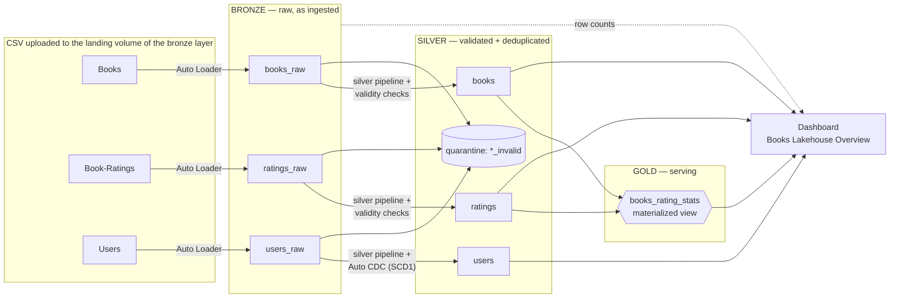
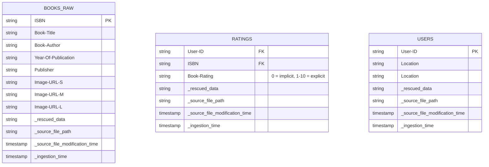
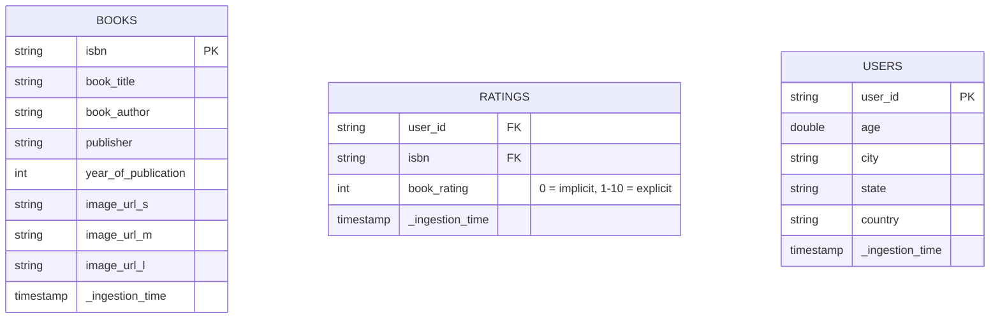
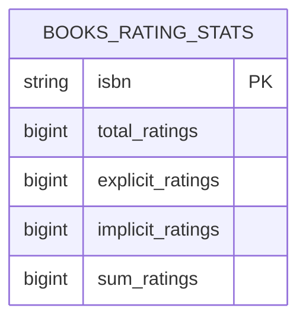
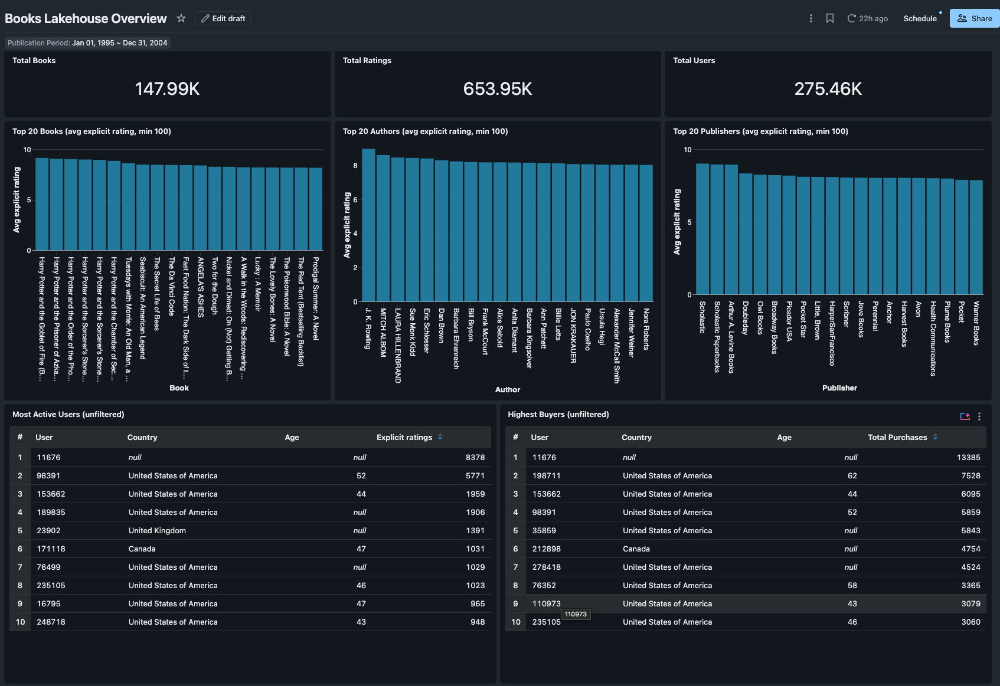
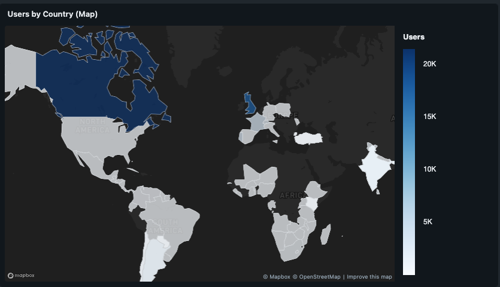
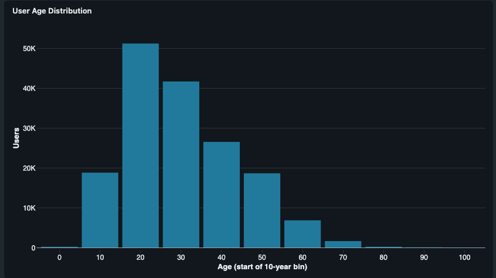

# Books Lakehouse — Architecture & Design

An end-to-end lakehouse for the [Book Recommendations dataset](https://www.kaggle.com/datasets/arashnic/book-recommendation-dataset/data), built on Databricks: medallion architecture (bronze → silver → gold), orchestrated as a **Declarative Automation Bundle (DAB)**, with a **dashboard** as the serving layer.

---

## 1. High-level architecture



**One rule drives the whole design:** bad rows are **quarantined, never dropped**. Every stream keeps a parallel `*_invalid` table so data-quality issues stay visible and debuggable.

---

## 2. Repository layout (DAB)

The bundle name is `books_dataset` with two targets — **dev** (`books_dataset_dev`, default) and **prod** (`books_dataset_prod`). A single `catalog` variable switches environments.

```text
books_dataset/
├── databricks.yml                        # bundle + targets
├── variables.yml                         # variable defaults
├── assets/
│   ├── ingestion_pipeline.yml            # end-to-end pipeline (autoloaders + silver pipelines + gold pipeline + dashboard refresh)
│   ├── silver_pipelines.yml              # silver streaming tables pipelines: books / ratings / users
|   |── gold_pipeline.yml                 # gold materialized view pipeline 
|   |── dashboards.yml                    # dashboard resource
│   ├── checks.yml                        # job that deploys the silver layer validity checks as functions (triggered once)
├── dashboards/
│   └── Books_Lakehouse_Overview.lvdash.json
├── src/books_dataset/
│   ├── bronze/
│   │   └── autoloader.py                 # CSV ingestion from landing volume
│   ├── silver/
│   │   ├── tables/                       # Auto CDC -> SCD 1 Streaming Tables + quarantine
│   │   │   ├── books.sql                
│   │   │   ├── ratings.sql
│   │   │   └── users.sql                 
│   │   └── checks/
│   │       └── validity_checks.sql       # UC functions: valid_book_data / valid_ratings_data / valid_users_data
│   └── gold/
│       └── views/
│           └── books_rating_stats.sql    # book-grain rating stats materialized view
└── infra/terraform/                      # workspace-level infra (catalogs, warehouses)
```

---

## 3. Layer by layer

### Bronze — raw as ingested

* One managed table per source file: `bronze.books_raw`, `bronze.ratings_raw`, `bronze.users_raw`.
* **Original column names preserved** (e.g. `Book-Author`, `Year-Of-Publication`, `ISBN`) plus ingestion metadata (`_ingestion_time`).
* Ingested with **Auto Loader** from a landing volume; checkpoints and inferred schemas live in dedicated volumes (`bronze.checkpoints`, `bronze.schemas`).
* Auto Loader is configured with `cloudFiles.schemaEvolutionMode = addNewColumns` and `rescuedDataColumn = _rescued_data`: new columns are tolerated, but any row that still does not match the schema or parsing expectations is not dropped silently; it is captured in the rescued column for inspection.

### Silver — validated, deduplicated, normalized

Each stream is a Lakeflow Spark Declarative Pipeline producing two streaming tables:

| Stream | Passed (`silver.<name>`) | Quarantined (`silver.<name>_invalid`) | Quality gate |
| --- | --- | --- | --- |
| Books | one row per ISBN, latest wins | failed `valid_book_data` | `Year-Of-Publication` → `TRY_CAST` to INT, non-null author/publisher, … |
| Ratings | one row per user-book pair, latest wins | failed `valid_ratings_data` | rating in 0–10, known ISBN/user shape, … |
| Users | one row per user via **Auto CDC (SCD1)**, keyed on `user_id` | failed `valid_users_data` | age sanity, location split into country/city/state, lower/trim/`NULLIF` normalization |

Design details worth calling out:

* **Check functions are Unity Catalog SQL UDFs** (`valid_book_data`, `valid_ratings_data`, `valid_users_data`), deployed by a dedicated job as a parameterized SQL file (with a `{{catalog}}` placeholder), so the same logic is reusable and testable outside the pipelines.
* **Latest-version-wins dedup** on natural keys (ISBN / user-book pair / user_id) driven by `_ingestion_time`.


### Gold — one additive materialized view

Deliberately minimal: a single metric view at **book grain** that pre-aggregates ratings so the dashboard can re-aggregate by any dimension (title, author, publisher, year) without precomputed averages.

`gold.books_rating_stats` (materialized view, one row per ISBN):

| Column | Meaning |
| --- | --- |
| `isbn`, `book_title`, `book_author`, `publisher`, `year_of_publication` | book attributes (from silver books) |
| `total_ratings` | all ratings received (explicit + implicit) |
| `explicit_ratings` | ratings with value > 0 (the 1–10 scale) |
| `implicit_ratings` | ratings with value = 0 |
| `sum_ratings` | sum of explicit rating values |

The core principle — **store additive quantities, compute averages at query time**:

```sql
Avg Explicit Rating = ROUND(SUM(sum_ratings) / NULLIF(SUM(explicit_ratings), 0), 2)
```

Because both operands are additive, this recomputes correctly under *any* grouping (by author, publisher, period, …) and under any filter combination. Precomputed per-book averages would silently produce wrong averages when re-averaged across books. (Distinct-rater counts are intentionally **not** stored — they are non-additive and would be misleading when summed.)

---

## 4. Data model
#### bronze layer


#### Silver layer


#### Gold layer

---

## 5. Dashboard design — Books Lakehouse Overview

A single-page dashboard built on four SQL datasets, each mapped to a specific widget group:

| Dataset | Source tables | Purpose | Widgets it serves |
| --- | --- | --- | --- |
| Gold Books (MV) | `gold.books_rating_stats` | Per-book rating stats, filtered by publication year | Total Books; Top 20 Books, Authors, and Publishers rankings; Author and Publisher filters |
| Silver Users | `silver.users` | Validated users with normalized country names and age bins | Total Users; Users by Country map; User Age Distribution; Country filter |
| Layer Counts | Bronze, silver, and gold tables for all three streams | Row counts per pipeline layer (bronze → silver → quarantined → gold), filtered by year | Total Ratings; Books, Ratings, and Users Rows by Layer charts |
| Top Users by Activity | `silver.ratings` joined to `silver.users` | Top users by explicit rating activity and total ratings, unfiltered | Most Active Users and Highest Buyers tables |

### Dashboard visuals

The full dashboard PDF is available in [docs/dashboard.pdf](docs/dashboard.pdf).



| Image | View |
| --- | --- |
|  |  |

---

## 6. Developer setup and deployment

Use the repo's devcontainer, which includes the Databricks CLI, Terraform, and Python tooling such as PySpark. A Databricks account and CLI login are required. On Free Edition, create the catalogs in the workspace first; Terraform creates their schemas and volumes, not the catalogs.

1. Authenticate to your workspace:

    ```bash
    databricks auth login --host <workspace-url> --profile free
    ```

2. Set the existing catalog names in `infra/terraform/terraform.tfvars`:

    ```hcl
    catalogs = ["books_dataset_dev", "books_dataset_prod"]
    ```

3. Create the schemas and volumes:

    ```bash
    cd infra/terraform
    terraform init
    terraform plan
    terraform apply
    ```

4. Return to the repository root, then validate and deploy the bundle. Use `-t prod` for production instead of `-t dev`:

    ```bash
    cd ../..
    databricks bundle validate -t dev
    databricks bundle deploy -t dev
    ```


